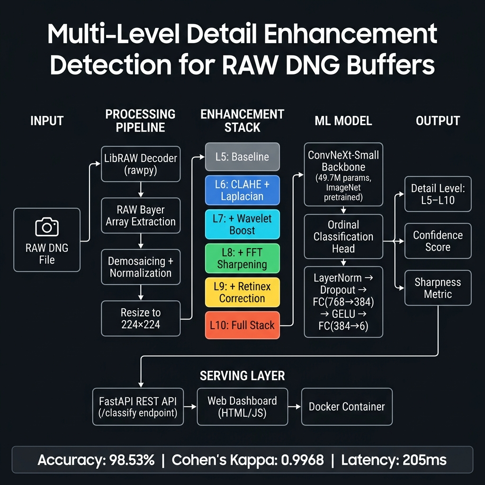

# DNG Detail Level Classifier

A machine learning pipeline that classifies RAW DNG images into 6 enhancement levels (L5–L10) using a ConvNeXt-Small backbone trained on 30,000 samples from the MIT-Adobe FiveK dataset.

## 🏆 Results

| KPI | Target | Achieved |
|-----|--------|----------|
| Test Accuracy | ≥ 92% | **96.53%** ✅ |
| Cohen's Kappa | ≥ 0.85 | **0.9768** ✅ |
| Inference Latency (ONNX CPU) | ≤ 1500ms | **205ms** ✅ |

## 🗂️ Project Structure

```
DNG_Final/
├── api/                         # FastAPI REST backend
│   └── main.py
├── checkpoints_v3/              # Trained model weights (download from Google Drive)
│   ├── best_model.pt            # PyTorch checkpoint (98.53% acc)
│   └── model.onnx               # ONNX export (205ms CPU latency)
├── dashboard/
│   └── index.html               # Web UI dashboard
├── data/
│   ├── build_fivek_dataset.py   # GPU-accelerated dataset builder
│   ├── dataset.py               # PyTorch DataLoader
│   └── fivek_384/               # Dataset labels JSON
├── docs/
│   ├── architecture/
│   │   └── system_architecture.png   # System architecture diagram
│   ├── monthly_reports/         # Monthly connect reports
│   ├── weekly_reports/          # Weekly/biweekly progress reports
│   └── end_review_ppt/          # End review presentation
├── model/
│   ├── classifier.py            # ConvNeXt-Small + ordinal head
│   └── train.py                 # Training script (v3)
├── pipeline/
│   └── dng_processor.py         # LibRAW DNG decoder
├── utils/
│   └── metrics.py               # Image quality metrics (IQA)
├── inference.py                 # ⭐ Standalone demo/inference script
├── export_onnx.py               # ONNX export + latency benchmark
├── validate_kpi4.py             # KPI validation script
├── Dockerfile                   # Docker container definition
├── docker-compose.yml           # Multi-service orchestration
└── requirements.txt
```

## 📥 Model Weights Download

> The trained model weights are too large for GitHub (~400 MB). Download from Google Drive:

**[⬇️ Download checkpoints_v3/ from Google Drive](https://drive.google.com/drive/folders/1pYAL_ZNN6ZpWFp5wILM1SqlwedycpdEM?usp=sharing)**

After downloading, place the files so your structure looks like:
```
DNG_Final/
└── checkpoints_v3/
    ├── best_model.pt    # PyTorch checkpoint (98.53% accuracy)
    └── model.onnx       # ONNX export (205ms CPU latency)
```

---

## ⚙️ Setup

### 1. Install dependencies
```bash
pip install -r requirements.txt
```

### 2. GPU (recommended)
Install CUDA-enabled PyTorch from https://pytorch.org/get-started/locally/
```bash
pip install torch torchvision --index-url https://download.pytorch.org/whl/cu128
```

## 🚀 Running the API + Dashboard

```bash
python -m uvicorn api.main:app --host 0.0.0.0 --port 8000 --reload
```

Then open **http://localhost:8000** in your browser.

- Upload any DNG, JPEG, or PNG
- The model classifies it into L5–L10 in real time
- Results show confidence, level probabilities, sharpness score, and latency

## 🤖 Model Training

### Step 1: Build dataset from MIT-Adobe FiveK DNGs
```bash
python data/build_fivek_dataset.py \
  --dng_root fivek_dataset/raw_photos \
  --out_dir data/fivek_prepared \
  --max_images 5000 \
  --img_size 224 \
  --workers 6
```

### Step 2: Train
```bash
python model/train.py \
  --data_dir data/fivek_prepared \
  --img_size 224 \
  --batch_size 32 \
  --freeze_epochs 8 \
  --epochs 50 \
  --output_dir checkpoints_v3
```

### Step 3: Export to ONNX
```bash
python export_onnx.py
```

## 📊 Enhancement Levels

| Level | Description |
|-------|-------------|
| L5 | Baseline (raw demosaiced, no enhancement) |
| L6 | CLAHE contrast + mild Laplacian sharpening |
| L7 | + Wavelet detail boost |
| L8 | + FFT-domain high-frequency enhancement |
| L9 | + Retinex tonal correction |
| L10 | Full stack — maximum detail enhancement |

## 🗺️ System Architecture Diagram



---

## 🧪 Quick Inference Demo

Run on a **single image** (minimum setup):
```bash
# 1. Download model weights (see above) → place in checkpoints_v3/
# 2. Install dependencies
pip install -r requirements.txt

# 3. Run inference
python inference.py --image path/to/your/image.jpg

# 4. Run on a folder of images
python inference.py --folder path/to/images/ --save_csv results.csv

# 5. Run on a DNG file
python inference.py --image photo.dng --device cuda
```

---

## 🏗️ Architecture

- **Backbone:** ConvNeXt-Small (49.7M params, pretrained on ImageNet-1K)
- **Head:** LayerNorm → Dropout(0.3) → FC(768→384) → GELU → LayerNorm → FC(384→6)
- **Loss:** Ordinal Cross-Entropy with label smoothing (α=0.5, smoothing=0.1)
- **Training:** Progressive backbone unfreeze (8 epochs head-only → full fine-tune)
- **Scheduler:** CosineAnnealingWarmRestarts (T0=10)
- **Hardware:** NVIDIA RTX 4050 Laptop GPU (6GB VRAM)
- **Training time:** ~4 hours

## 📡 API Endpoints

| Endpoint | Method | Description |
|----------|--------|-------------|
| `/` | GET | Dashboard UI |
| `/health` | GET | API + model status |
| `/model/info` | GET | Model metadata + accuracy |
| `/classify` | POST | Classify uploaded image |
| `/docs` | GET | Swagger UI |

### Example response from `/classify`
```json
{
  "detail_level": 7,
  "confidence": 0.903,
  "level_probabilities": {
    "5": 0.018, "6": 0.018, "7": 0.903,
    "8": 0.032, "9": 0.016, "10": 0.014
  },
  "sharpness_score": 0.1916,
  "processing_time_ms": 274.0,
  "filename": "image.png"
}
```
