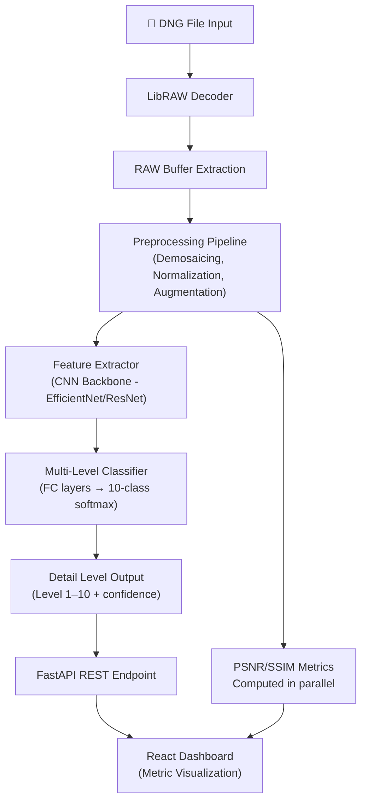

# 📷 Samsung: Multi-Level Detail Enhancement Detection for RAW DNG Buffers
### Complete Project Roadmap & Implementation Guide

---


---

## 🎯 What You're Actually Building

At its core, you're building **3 things**:

| Component | What it does |
|---|---|
| **DNG Pipeline** | Reads `.dng` files → extracts RAW buffer → preprocesses |
| **ML Classifier** | Takes RAW buffer → outputs detail level (1–10) |
| **API + Dashboard** | FastAPI backend + React frontend to demo results |

---

## 🗂️ Project Architecture



---

## 🗓️ 6-Month Sprint Plan

### Month 1 — Literature Review + Setup (Kick Off)
**Owner: All 4 members**

- [ ] Read papers on IQA (Image Quality Assessment): BRISQUE, NIQE, MUSIQ
- [ ] Study DNG spec: [Adobe DNG spec PDF](https://helpx.adobe.com/content/dam/help/en/photoshop/pdf/dng_spec_1_7_1_0.pdf)
- [ ] Install and test `rawpy` (Python wrapper for LibRAW)
- [ ] Set up GitHub repo, Python environment, Docker base image
- [ ] Collect initial DNG dataset (Samsung camera samples, open datasets)

**Key output:** Working DNG reader that dumps RAW buffer to numpy array

---

### Month 2–3 — DNG Pipeline + Dataset Creation (Milestone 1)
**Owner: 2 members on pipeline, 2 on dataset**

#### Pipeline (Members 1 & 2)
```python
# Core pipeline structure you'll build
import rawpy
import numpy as np
import cv2

def extract_raw_buffer(dng_path: str) -> np.ndarray:
    with rawpy.imread(dng_path) as raw:
        # Get the raw Bayer array
        raw_array = raw.raw_image_visible.copy()
        # Normalize to [0, 1]
        raw_array = raw_array.astype(np.float32)
        raw_array = (raw_array - raw_array.min()) / (raw_array.max() - raw_array.min())
    return raw_array

def preprocess_for_model(raw_buffer: np.ndarray) -> np.ndarray:
    # Demosaicing (convert Bayer to RGB)
    # Resize to model input (e.g., 512x512)
    # Apply CLAHE for local contrast
    pass
```

#### Dataset (Members 3 & 4)
- Collect **500–1000 DNG images** at varying quality levels
- Apply controlled degradations (blur, noise, compression) to create 10 quality levels
- Use **PSNR + SSIM** to verify the 10 levels are meaningfully separated
- Label each image with a quality level (1 = poorest detail, 10 = best)

> [!TIP]
> Use Samsung Galaxy RAW samples + open datasets like MIT-Adobe FiveK (5,000 DNG files, free). This alone gives you a solid base.

---

### Month 4 — Model Training + Validation (Milestone 2)

#### Model Architecture
```python
import torch
import torch.nn as nn
from torchvision import models

class DetailLevelClassifier(nn.Module):
    def __init__(self, num_classes=10):
        super().__init__()
        # Use EfficientNet-B3 as backbone (fast + accurate)
        self.backbone = models.efficientnet_b3(pretrained=True)
        
        # Replace classifier head
        in_features = self.backbone.classifier[1].in_features
        self.backbone.classifier = nn.Sequential(
            nn.Dropout(p=0.3),
            nn.Linear(in_features, 256),
            nn.ReLU(),
            nn.Linear(256, num_classes)
        )
    
    def forward(self, x):
        return self.backbone(x)
```

#### Training Strategy
| Step | Details |
|---|---|
| **Loss** | Cross-Entropy + Ordinal loss (levels are ordered, not random) |
| **Optimizer** | AdamW, lr=1e-4, weight decay=1e-2 |
| **Scheduler** | CosineAnnealingLR |
| **Augmentation** | Random flip, crop, brightness jitter |
| **Validation** | 80/10/10 train/val/test split |

#### Hitting the KPIs
| KPI | Target | How to hit it |
|---|---|---|
| Accuracy ≥ 92% | 10-class classification | Use pretrained backbone + fine-tune; ordinal loss helps |
| Processing ≤ 1.5s | Per image end-to-end | Use EfficientNet-B0 (lighter) + ONNX export + batch=1 |
| Inter-rater Reliability ≥ 0.85 | Cohen's Kappa | Ensure dataset labels are consistent; use agreement scoring |
| PSNR/SSIM Correlation ≥ 0.9 | Pearson r | Verify dataset labels correlate with computed metrics |

---

### Month 5 — API + Dashboard (Closure Phase)

#### FastAPI Backend
```python
from fastapi import FastAPI, UploadFile
import torch

app = FastAPI()
model = torch.load("detail_classifier.pt")

@app.post("/classify")
async def classify_dng(file: UploadFile):
    raw_buffer = extract_raw_buffer(await file.read())
    tensor = preprocess_for_model(raw_buffer)
    
    with torch.no_grad():
        logits = model(tensor.unsqueeze(0))
        level = logits.argmax().item() + 1  # 1-10
        confidence = torch.softmax(logits, dim=1).max().item()
    
    psnr, ssim = compute_metrics(raw_buffer)
    
    return {
        "detail_level": level,
        "confidence": round(confidence, 3),
        "psnr": psnr,
        "ssim": ssim,
        "processing_time_ms": ...
    }
```

#### React Dashboard
- Upload DNG → show detail level (1–10 scale with visual gauge)
- Display PSNR/SSIM metrics
- Show confidence histogram across levels

---

### Month 6 — Testing, Docker, AWS Deployment

- Containerize with Docker
- Deploy on AWS EC2 (g4dn.xlarge for GPU inference)
- Write benchmarks to validate all 4 KPIs
- Prepare final report and demo

---

## 📦 Tech Stack & Libraries

```
Python 3.10+
├── rawpy          # DNG decoding (LibRAW wrapper) → pip install rawpy
├── numpy / opencv # Image processing
├── torch + torchvision  # Model training
├── scikit-image   # PSNR, SSIM metrics
├── fastapi + uvicorn    # REST API
├── onnxruntime    # Fast inference (optional)
└── wandb          # Training experiment tracking (free)

Frontend: React + Recharts (for metric graphs)
Deploy: Docker + AWS EC2 / Lambda
```

---

## 🚦 Risk Register

| Risk | Mitigation |
|---|---|
| Not enough DNG data | Use MIT-Adobe FiveK + synthetic augmentation to reach 10 levels |
| <92% accuracy | Switch from 10 to 5 levels first, then scale up |
| >1.5s processing | Export to ONNX, use half-precision (fp16), or reduce input resolution |
| Team coordination | Weekly standups, GitHub Issues for task tracking |

---

## 👥 Suggested Team Split (4 Members)

| Member | Role | Focus |
|---|---|---|
| Member 1 | **ML Lead** | Model architecture, training loop, KPI validation |
| Member 2 | **Data Engineer** | DNG pipeline, dataset creation, augmentation |
| Member 3 | **Backend Dev** | FastAPI, Docker, AWS deployment |
| Member 4 | **Frontend + Docs** | React dashboard, technical documentation, benchmark report |

---

## ✅ Immediate Next Steps (This Week)

1. `pip install rawpy numpy opencv-python torch torchvision scikit-image fastapi`
2. Download 10 DNG files from [MIT-Adobe FiveK](https://data.csail.mit.edu/graphics/fivek/) to test the pipeline
3. Run `rawpy.imread("test.dng")` and verify you can read the raw buffer
4. Set up a GitHub repo with the folder structure below

```
project/
├── data/          # DNG files
├── pipeline/      # DNG decoding + preprocessing
├── model/         # Architecture + training scripts
├── api/           # FastAPI app
├── dashboard/     # React frontend
├── notebooks/     # Experimentation
└── docker/        # Dockerfiles
```

> [!NOTE]
> Start with `rawpy` + a simple ResNet-18 classifier on 3 quality levels first. Get one full pipeline working end-to-end before scaling to 10 levels. This builds confidence and catches bugs early.

